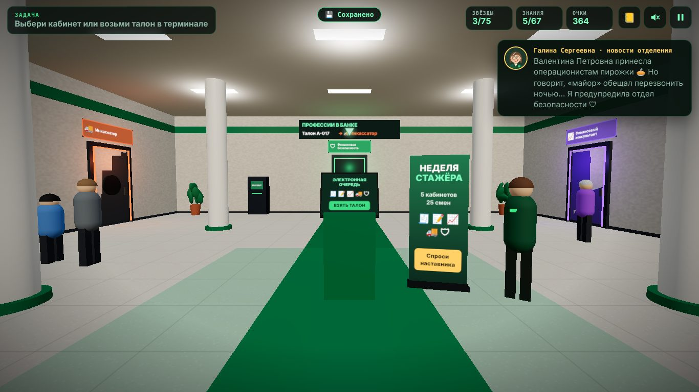

# ПРОФЕССИИ В БАНКЕ

3D-игра от первого лица для детей и подростков (7–15 лет). Игрок проводит **неделю стажёром в банке**: гуляет по холлу,
выбирает кабинет и пробует профессию изнутри. **7 профессий × 5 смен = 35 смен**, в каждой — своя сторона профессии:
операционист, кредитный эксперт, финансовый консультант, инкассатор, специалист по финансовой безопасности,
**HR-специалист** и **DevOps-инженер** (с заданиями DevSecOps — безопасной разработки).
Все кабинеты связывает **один сюжет**: на этой неделе мошенники атакуют клиентов банка, а люди, которым игрок помог
в одном кабинете, приходят в другие.

Игра работает прямо в браузере, на компьютере и телефоне. Регистрация не нужна, игра спрашивает только никнейм.



## Запуск

Игра — статический сайт без сборки. Её нужно открыть через любой веб-сервер: при открытии `index.html` как файла
браузер заблокирует ES-модули.

```bash
python3 -m http.server 8000
# открыть http://localhost:8000
```

### Деплой на Vercel (рекомендуем)

Игра — статический сайт, сборка не нужна. В корне уже лежат `vercel.json` (кэш для Three.js, заголовки безопасности,
прокси `/api/cbr` для курсов ЦБ) и `.vercelignore` (тесты и скриншоты в деплой не попадают).

**Через сайт (2 минуты):**
1. Залить папку в репозиторий на GitHub.
2. [vercel.com](https://vercel.com) → **Add New… → Project** → выбрать репозиторий → **Import**.
3. Framework Preset: **Other**. Build Command — пусто, Output Directory — `.` (корень). **Deploy**.
4. Через минуту игра доступна по ссылке вида `https://<проект>.vercel.app`. Каждый `git push` обновляет её сам.

**Через консоль:**
```bash
npm i -g vercel
cd center-invest-game
vercel          # первый раз: войти и создать проект
vercel --prod   # выложить в продакшен
```

После деплоя сделай два QR-кода для презентации: на ссылку игры и на репозиторий.

**Статистика для HR:** Vercel → Storage → Create Database → Neon (Postgres) → Connect → Redeploy. Дальше —
дашборд Superset одной командой, см. [`analytics/README.md`](analytics/README.md).

Запасной вариант — GitHub Pages: Settings → Pages → Source: `Deploy from a branch`, ветка `main`, папка `/ (root)`.
Three.js лежит в `vendor/`, поэтому игра не зависит от CDN.

## Как устроена игра

**Наставник** — Галина Сергеевна, управляющая отделением. 25 лет назад она пришла сюда стажёром-операционистом
(живой пример карьеры в банке). Встречает игрока в первый день, рассказывает новости отделения после каждой смены
(как решения игрока изменили жизнь клиентов) и в конце недели вручает сертификат с итогами.

**Холл — настоящее отделение банка**, по которому можно ходить и всё рассматривать: операционный зал с тремя окнами
за стеклом и табло очереди, столы консультантов, зона банкоматов 24/7, табло курсов валют, охранник у входа, стойка
с буклетами (советы по финансовой грамотности), плакат против мошенников, кулер, «Стена благодарностей» и напротив неё —
**карьерный стенд** с профилем стажёра. Над окнами — световой короб с логотипом банка, на стенах табло курсов ЦБ,
бегущая строка и часы. Люди в холле живые: замечают игрока, поворачивают к нему голову, моргают;
наставник, охранник и гости поворачиваются к тебе целиком.
По стенам — семь дверей кабинетов с подсветкой цвета профессии и звёздами прогресса. Холл вытянут вглубь: у входа —
клиентская зона, дальше под указателем «← HR · DevOps →» — двери офиса банка, в самом конце — операционный зал
и «Финансовая безопасность». Все двери открыты сразу. Можно подойти к двери или взять талон в терминале электронной очереди.

**Кабинет** — у каждой профессии своя 3D-комната: окно кассы, стол кредитного эксперта, уютный кабинет консультанта,
гараж инкассации с броневиком, офис безопасности, светлый кабинет HR с круглым столом для собеседований и тёмная
«серверная» DevOps со стеной мониторинга и мигающими стойками. В кабинете — карта 5 смен и карточка «А в жизни»: что делает
специалист, какие качества нужны, где учиться.

**Смена** = заставка → задания в 3D-комнате (подойти к предмету, нажать) → разбор: звёзды, последствия решений,
«🧵 Сюжет недели», новые карточки знаний, «профессия по кусочкам». Ошибки не наказываются сразу: они возвращаются
«через пару дней», «месяц спустя» или «в новостях города».

## Сквозной сюжет недели

Антагонист недели — сеть мошенников с «куратором» во главе. Её следы есть в каждом кабинете, а вычисляют куратора
в финале отдела безопасности. Персонажи переходят из профессии в профессию, и исход в одном кабинете меняет другой.
Кабинеты можно проходить в любом порядке: каждая реплика проверяет, что игрок уже видел, и либо вспоминает прошлое,
либо намекает на будущее.

| Персонаж | Где появляется | Как связано |
|---|---|---|
| 👵 Валентина Петровна, 72 | Операционист (смена 1) → Безопасность (смены 1, 4, 5) | У окна кассы её уговаривают перевести всё на «безопасный счёт». Если игрок её спас, ночью в звонке она узнаёт его голос: **+15 доверия** и плашка «Она тебя знает» |
| 🕵️ Максим и «друг» Руслан | Кредитный эксперт (смена 1) → Безопасность (смена 5) | Подставной заёмщик. «Друзья» вербуют молодёжь на ту же сеть, что и дропы в расследовании |
| 📱 Артём, 19 | Операционист (смена 1) → Консультант (смена 4) → Кредитный эксперт (смена 4) | Платит штраф, хочет айфон в кредит, а потом приходит за кредитом на электровелосипед. Робот-скоринг ему отказывает, но игрок видит его накопления |
| 🥐 Пекарня «Каравай» | Инкассатор (смена 1) ↔ Кредитный эксперт (смена 5) | Хозяйка пекарни говорит с инкассатором по-разному: мечтает о новой печи, благодарит за кредит или сдаёт выручку «вам, хоть кредит дали другие» |
| 🚘 Серый седан А 777 МР | Инкассатор (смена 1) → Безопасность | Хвост за броневиком работает на ту же сеть |
| 🚲 Миша, 11 | Консультант (смена 1) | «Удвоим деньги» в игре рассылают те же мошенники |
| 🕵️ Руслан — инсайдер | Кредитный эксперт (смена 1) → HR (смена 1) → DevOps (смена 4) | Тот самый «друг» Максима пытается устроиться в банк операционистом по поддельному диплому. Если HR его возьмёт, в «Доступах» DevOps он уже выгружает базу клиентов |
| 🎒 Маша, 18 | Безопасность (смена 5) → HR (смена 5) → DevOps (смена 4) | Внучка Валентины Петровны выходит стажёркой. Заявка HR на её доступы приходит DevOps-инженеру — лишнее придётся отозвать |
| 🔐 Аккаунт Валентины Петровны | DevOps (смена 3) | Та же сеть подбирает пароли клиентов мобильного банка — и уже вошла в её приложение |

Где виден сюжет: новости наставника в холле, блок «🧵 Сюжет недели» в разборе каждой смены и итоги недели в сертификате.

## Первые смены — самые яркие

Первая смена каждой профессии построена вокруг её главного момента, чтобы игрока сразу затянуло:

| Профессия | Кульминация первой смены |
|---|---|
| 🧾 Операционист | Последней к окну подходит Валентина Петровна с телефоном у уха: «переведите всё на безопасный счёт!». Тревожная музыка и сердцебиение, разговор со шкалой доверия, экран «180 000 ₽ спасено» |
| 📝 Кредитный эксперт | Максим приходит с «другом», который отвечает за него на все вопросы. Поговорить наедине и спасти парня от чужого долга в 500 000 ₽, а через месяц увидеть, чем всё кончилось |
| 📈 Консультант | Велосипед Миши собирается по деталям, пока растёт копилка. Посреди перемотки «удвоители» из игры предлагают перевести 1 000 ₽. В финале Миша уезжает на велосипеде |
| 🚚 Инкассатор | По дороге в зеркале заднего вида снова и снова появляется серый седан. Заметить хвост, сообщить диспетчеру и уехать к полиции. Хозяйка «Каравая» выносит сумку |
| 🛡 Безопасность | Счётчик рассылки растёт в реальном времени, пока игрок разбирает фишинг. Финал «Атака отбита» и первое упоминание Валентины Петровны |
| 🤝 HR | Весь цикл найма за смену: убрать дискриминацию из вакансии, собеседовать трёх кандидатов (запретные вопросы — ловушки), проверка с согласия, давление начальника «возьми помоложе». **Кульминация:** идеальный кандидат Руслан — поддельный диплом и номер из дела о мошенниках |
| ⚙️ DevOps | Собрать конвейер CI/CD из станций проверки под реальный список изменений, разобрать находки (ключ платёжного сервиса в коде, Log4Shell, ложные тревоги) и выкатить релиз к 18:00. **Кульминация:** «утро после релиза» — что случилось бы с каждой пропущенной дырой |

## Профиль стажёра — профориентация

Главный вопрос игры — «какая работа в банке подходит мне?». Ответ появляется не через 35 смен, а как только игрок
сыграл **хотя бы одну смену в любых 5 кабинетах из 7** (обычно это первые смены — самые яркие). Наставник сама
показывает профиль, а потом он всегда доступен на **карьерном стенде** в холле и из пропуска (кнопка с аватаром).

Профиль складывается из игры, отдельного теста нет:

- **Стиль игры** по пяти сторонам — 🗣 общение, 📊 расчёт, 🔎 внимательность, ⚡ выдержка, 🧩 системность. Каждая смена тренирует
  свои стороны (например, «Собеседование» — общение и внимательность, «Хвост» — внимательность и выдержка), а звёзды
  показывают, насколько получилось. Ключевые моменты сюжета весят больше: спас бабушку в разговоре — растёт общение,
  заметил хвост за броневиком — внимательность и выдержка.
- **Интерес:** после каждой смены один тап — «Как тебе эта работа? 😍 / 🙂 / 😐». В профориентации интерес не менее
  важен, чем способности, поэтому он весит больше всего.
- **Результат:** «Тебе подходит: …» с процентом совпадения и причинами, «Ещё присмотрись», все профессии по местам,
  и **что дальше**: где учиться на эту профессию и как попасть в банк «Центр-инвест» (оплачиваемая стажировка с
  наставником; путь — заявка на сайте → ускоренное обучение «Банковское дело» → работа в отделении; ссылка на страницу
  «Карьера» банка).
- **Карточка для друзей:** картинка 1080×1350 с аватаром, именем, профессией и стилем — скачать одним нажатием,
  на телефоне — «Поделиться» прямо в мессенджер. Внизу адрес игры: друзья приходят попробовать сами.

В режиме для жюри (ссылка «Смены» на титульном экране) профиль показывается предварительно уже после первой смены.

## Анонимная статистика для HR (Superset)

Игра пишет анонимные события (без имён, IP и регистрации): какие профессии открывают и проходят, ответ «Как тебе эта
работа?», что посоветовал профиль стажёра, переход на страницу «Карьера» банка. Цепочка: игра → функция Vercel
`api/events.js` → Postgres → дашборд **Apache Superset** «Профессии в Банке — HR-аналитика» (12 графиков: главные цифры,
выбор профессий, «понравилось», воронка до страницы стажировки, рекомендации профиля, возраст × профессия, по дням,
устройства). Дашборд собирается одной командой `analytics/superset/bootstrap.py`; проверен на Superset 4.1.2 с Postgres 16.
Superset живёт отдельно от Vercel — на своём сервере с доменом (`setup-vps.sh`: Docker + HTTPS), на ноутбуке или у банка; варианты — в `analytics/README.md`.
Статистику можно выключить на титульном экране, а при «Не отслеживать» в браузере она не отправляется. Подробно —
[`analytics/README.md`](analytics/README.md).

## Логотип банка

В папке `brand/` два варианта фирменного знака «Центр-инвеста» — с прозрачным фоном, в фирменном зелёном:

- `logo.png` — **широкий баннер** (знак + «Банк Центр-инвест») для больших мест: световой короб над окнами
  операционистов (виден сразу от входа), ролл-ап «Неделя стажёра», карьерный стенд, титульный экран, профиль,
  сертификат, карточка для друзей;
- `emblem.png` — **только знак** для маленьких мест: табло над входом в «Финансовую безопасность», банкоматы,
  коврик «Добро пожаловать» у входа.

В 3D логотип лежит на светлой плашке чуть темнее чисто-белого: так он не попадает под эффект свечения (bloom),
который «засвечивал» зелёный на белом. Нет файлов (или вместо них заглушки 1×1) — игра работает без логотипа.

## Курсы ЦБ и живые мелочи холла

- **Табло курсов валют** берёт официальные курсы ЦБ РФ на сегодня: доллар, евро, юань, стрелка ▲▼ к вчерашнему
  курсу и дата. Покупка и продажа считаются от курса ЦБ с примерной маржой банка — заодно урок «банк покупает
  дешевле, а продаёт дороже» (нажми E на табло). Источник — JSON-зеркало курсов ЦБ `cbr-xml-daily.ru`
  (официальный XML ЦБ браузер с чужого сайта прочитать не даёт): на Vercel запрос идёт через свой адрес `/api/cbr`
  (прокси в `vercel.json`), локально — напрямую; ответ кешируется на 6 часов. Нет связи — табло честно пишет
  «примерные».
- **Бегущая строка** над консультациями: курсы ЦБ, советы по финансовой грамотности и «Стажёр недели — {имя игрока}».
- **Часы** над банкоматами показывают настоящее время, а **небо за окнами** — время суток у игрока: день, закат
  с огнями в окнах, ночь со звёздами.
- **Наставник здоровается по времени суток** («Доброе утро», «Добрый вечер», ночью — «Не спится?»).
- Тихий **«дин-дон» электронной очереди**, когда на табло меняется талон (только в холле и не на паузе).

## Профессии и смены

### 🧾 Операционист

| Смена | Навык | Что делает игрок |
|---|---|---|
| 1. Первый день | Платежи | Понимает запрос «по-человечески», переносит реквизиты из квитанции, выдаёт сдачу. **Кульминация:** Валентина Петровна и «безопасный счёт» |
| 2. Касса | Наличные | Пересчитывает купюры, проверяет УФ-лампой, находит подделку и недостачу |
| 3. Новый клиент | Открытие счетов | Сверяет фото в паспорте с лицом, вежливо отказывает 12-летнему, подбирает продукт под цель |
| 4. Переводы | Переводы | Проверяет каждую цифру в реквизитах, торопливый бизнесмен, звонок «следователя»: «внук в беде» |
| 5. Сверка кассы | Валюта и сверка | Курс покупки/продажи, срочная блокировка карты, сверка кассы в конце дня |

### 📝 Кредитный эксперт

| Смена | Навык | Что делает игрок |
|---|---|---|
| 1. Первые заявки | Нагрузка на бюджет | Правило «платёж ≤ ⅓ дохода», мягкое решение (дольше срок). **Кульминация:** Максим и «друг», который отвечает за него |
| 2. Не сходится | Проверка документов | Как в Papers, Please: отмечает два факта, которые не сходятся, ищет поддельную справку |
| 3. Собеседование | Собеседование | Задаёт вопросы и сверяет ответы с документами: скрытые кредиты, честный, но перегруженный заёмщик |
| 4. Скоринг | Скоринг и залог | Робот советует, решает игрок: чужой паспорт при высоком скоринге, Артём с накоплениями при низком; кредит не больше цены залога |
| 5. Пекарня | Кредиты бизнесу | Пекарня «Каравай»: читает график выручки, предлагает страховку; итог — портфель «полгода спустя» |

После каждой смены календарь перелистывается: карточки заёмщиков горят зелёным, жёлтым или красным.

### 📈 Финансовый консультант

Главная фишка — **перемотка времени**: игрок составляет план, месяцы летят, падают соблазны, подарки и беды,
и жизнь проверяет план. В финале каждой истории — короткая сценка.

| Смена | Клиент и цель | Механика |
|---|---|---|
| 1. Велосипед | Миша, 11 лет: велосипед | **Трубы денежного потока**: краны можно закрыть или прикрутить наполовину, «нужное» не режется. Велосипед собирается по деталям, «удвоители» из игры, финал — Миша уезжает на велосипеде |
| 2. Подушка | Катя, студентка: ноутбук | Подушка безопасности. В перемотке разбивается телефон: без запаса придётся брать из цели или брать микрозайм с переплатой |
| 3. Отпуск | Семья Петровых: море | Выбор продукта: копилка, накопительный счёт или вклад. Инфляция дважды поднимает цену путёвки, а вклад нельзя снять раньше срока |
| 4. Айфон в кредит? | Артём, 19, и его бабушка | Посчитать переплату по рекламе «всего 6 300 ₽/мес», объяснить каждому на его языке, а в перемотке накопленные деньги соревнуются с кредитом |
| 5. Пирамида | Олег: учёба дочки через 5 лет | Найти признаки пирамиды в листовке, отговорить в разговоре, построить план на 5 лет — «снежный ком» процентов. Пирамида рушится на 4-м месяце. Финал — «сарафанное радио» от клиентов недели |

Во всех сменах есть шкала **доверия**: если объяснил неудачно или резал нужное, клиент может не послушать совета в момент соблазна.

### 🚚 Инкассатор

Никакой стрельбы и погонь: герой — тот, кто заметил угрозу и действовал по протоколу. Каждая смена — три фазы:
**карта маршрута → выезд на броневике → сдача в хранилище**.

| Смена | Навык | Что делает игрок |
|---|---|---|
| 1. Первый маршрут | Маршрут | Строит маршрут с окнами времени (пекарня закрывает кассу в 9:45), проверяет пломбы. **Кульминация:** серый седан в зеркале — сообщить и уехать к полиции |
| 2. Хранилище | Процедуры | Маршрут не должен совпадать со вчерашним (он показан пунктиром). Напарник зовёт за кофе с деньгами в машине. В хранилище — порядок действий и сверка с ведомостью |
| 3. Хвост | Бдительность | Серых седанов теперь два: нужно сверять номера в зеркале. У отделения — учебная проверка службы безопасности |
| 4. Банкоматы | Банкоматы | Пятница, пробки в центре: какой банкомат опустеет первым? Раскладывает пачки по кассетам: номинал к номиналу. Ошибки попадают в «новости города» |
| 5. Снегопад | Старший бригады | Полный цикл: снег замедляет, распределение ролей в бригаде, перекрытая улица и объезд, «водитель, сбегай за сумкой», не так, как вчера |

Оценка безопасности — главная: нарушение правил снижает её, даже если ничего плохого не случилось.

### 🛡 Специалист по финансовой безопасности

| Смена | Навык | Что делает игрок |
|---|---|---|
| 1. Рассылка | Распознавание фишинга | Тапает по уликам в СМС и письмах, пока счётчик рассылки растёт. Финал «Атака отбита» |
| 2. Поток | Мониторинг операций | Свайпает платежи: пропустить или заблокировать |
| 3. Правило | Антифрод-система | Собирает правило и проверяет его на вчерашних операциях |
| 4. Безопасный счёт | Работа с клиентами | Звонок пенсионерке, пока «майор ФСБ» на второй линии |
| 5. След денег | Расследование | Доска с нитями: дропы, транзитная карта, куратор |

### 🤝 HR-специалист

Всё — по Трудовому кодексу (ст. 3, 64, 65, 70, 86 ТК РФ) и закону о занятости (565-ФЗ, ст. 53): игра учит не только
находить людей, но и не нарушать их права. После каждой смены календарь «испытательный срок» показывает, кем человек
оказался через 1–3 месяца.

| Смена | Навык | Что делает игрок |
|---|---|---|
| 1. Первая вакансия | Подбор без дискриминации | Вычёркивает из вакансии «девушка 20–30 лет», «славянской внешности», «прописка», «без детей» (риск штрафа до 15 000 ₽); собеседует трёх кандидатов — три вопроса на каждого, запретные вопросы про детей, возраст и веру — ловушки; проверка только с согласия (справку о несудимости для операциониста требовать нельзя); начальник давит «возьми молодого». **Кульминация:** Руслан — поддельный диплом, несуществующая фирма, номер из дела о мошенниках |
| 2. Поток резюме | Отбор резюме | 10 откликов на стажировку: отсеять только по обязательным требованиям, «слепой режим» прячет имя, возраст и фото. Мама троих детей, пробел в стаже, кандидат на коляске, пенсионер-учитель — подходят; резюме «21 год, 10 лет топ-менеджером» — нет |
| 3. Собеседование | Метод STAR | Уточняет ситуацию, задачу, действие и результат: «мы всей командой» и «в целом по отделу» — туман, конкретные цифры — факты. Эффект ореола: красный диплом против реального опыта |
| 4. Проверка | Проверка кандидатов | Вакансия инкассатора: тут справка о несудимости и медкомиссия нужны по закону. Согласие кандидатов, затем досье СБ: в порядке / обсудить / закон запрещает / учитывать нельзя (погашенная судимость, судимость отца, брат-полицейский, профсоюз) |
| 5. Первый день | Адаптация | Стажёрка Маша: план первого дня (без «сразу одна на кассу»), заявка на доступы по минимуму, вечерний разговор со шкалой доверия — останется ли она в банке |

### ⚙️ DevOps-инженер (DevSecOps)

Проверки безопасности встроены прямо в конвейер выпуска — как в ГОСТ Р 56939-2024 «Разработка безопасного ПО»
и требованиях Банка России к ПО для банковских операций (683-П). Термины объясняются на языке подростка.

| Смена | Навык | Что делает игрок |
|---|---|---|
| 1. Первый релиз | Конвейер CI/CD | Читает список изменений и собирает конвейер из станций (поиск секретов, SCA, автотесты, SAST, сканер контейнера, подпись) в пределах времени до 18:00. Разбирает находки: ключ платёжного сервиса в коде (стереть мало — надо сменить), Log4Shell (CVE-2021-44228), ошибка комиссии, ложные тревоги. Утром — последствия каждой пропущенной дыры |
| 2. Ночное дежурство | Мониторинг и аварии | Живые графики в 3 часа ночи: сломался релиз → откат, логи съели диск → ротация, трафик ×50 → анти-DDoS. Неверные действия стоят минут, а клиенты не могут войти. Утром — разбор без поиска виноватых |
| 3. Атака | Логи и защита входа | Поток логов входа: найти адрес, который подбирает пароли, взломанный аккаунт Валентины Петровны и вход бывшего подрядчика; не принять за атаку Мишу, забывшего пароль. Меры: лимит попыток, второй фактор, а «выключить вход всем» бьёт по честным клиентам |
| 4. Доступы | Минимум прав | Таблица доступов: стажёру — только нужное (заявка из смены HR), разработчику — без админки боевых серверов, подрядчику с закончившимся договором — ничего, роботу сборки — узкая роль |
| 5. Большой релиз | Канареечный релиз | Конвейер с подменённым пакетом «reqeusts», неподписанной сборкой и SQL-инъекцией, затем выкатка по шагам 1% → 10% → 50% → 100%: на 10% новая версия падает на Android — откатить или выключить функцию флагом |

### Как добавить профессию

Профессия — это данные, а не правка движка. HR и DevOps добавлены именно так:
1. Объект в `js/data/professions.js`: название, цвет, «А в жизни», 5 смен; шаг смены — `run: 'файл:функция'`.
2. Механика в `js/episodes/<файл>.js` (функция получает `ctx` и смену, возвращает звёзды и последствия) и тексты в `js/data/<файл>.js`.
3. Комната `js/rooms/<id>.js` и дверь в `DOORS` холла (`js/rooms/lobby.js`); карточки знаний с префиксом.
4. Вес смен в профиле (`js/data/career.js`), id в `js/save.js` и в белом списке аналитики (`api/events.js`, `analytics/views.sql`).

## Сложность (возраст)

| | Лёгкая (7–10) | Средняя (11–13) | Сложная (14+) |
|---|---|---|---|
| Подсказки | Подсвечено лишнее, светофор нагрузки, цвета купюр и кассет | Часть подсказок | Без подсказок |
| Расчёты | Игра считает сама | Показан пример расчёта | Срок, переплату и сдачу считает игрок |
| Объём | Меньше клиентов и точек | Полный | Полный + обманки (похожий седан, перемешанные кассеты) |

## Сохранение

Игра сохраняется автоматически: в начале смены, после каждого задания и в конце. Данные лежат в `localStorage`.
На титульном экране — «Продолжить», в каждом кабинете — карта смен со звёздами, любую открытую смену можно переиграть.
После всех 35 смен наставник вручает сертификат: какая профессия получилась лучше всего и как прошла неделя.

**Режим жюри:** на титульном экране кнопка «Смены: по порядку / все открыты». В режиме жюри все 35 смен доступны сразу.

## Тестирование

Папка `tests/`: сценарии на Playwright, которые сами играют в смены. Запуск: поднять сервер в папке игры
(`python3 -m http.server 8765`), затем `cd tests && npm i && npx playwright install chromium && node advisor.mjs 1 normal good`.
Скриншоты прогона складываются в `tests/shots/`.

- `advisor.mjs`, `cash.mjs` — «умный игрок» проходит любую смену консультанта и инкассатора правильно (`good`) или с ошибками (`bad`) на любой сложности, на компьютере и телефоне (`390 844`)
- `hr.mjs`, `devops.mjs` — то же для HR и DevOps (`node hr.mjs 1 normal good`); `devops.mjs 4 normal good 1 1366 768 insider` — сюжетный вариант, когда HR взял Руслана
- `newui.mjs` — общие экраны с семью профессиями: титул, терминал очереди, пропуск, профиль, карточка для друзей, альбом
- `firsts.mjs` — первые смены и сквозной сюжет: операционист → холл → кредит → холл → безопасность (смены 1 и 4)
- `monkey.mjs` — «обезьянка» жмёт случайные кнопки в любой профессии и ловит ошибки JavaScript
- `smoke.mjs` — быстрый запуск: титульный экран, холл, первый кабинет
- `screens.mjs` — все экраны вне смен (титул, приветствие, холл, терминал, двери, наставник, стена благодарностей,
  пропуск, альбом, пауза, кабинет, заставка, подсказки) на любом размере экрана
- `lock.mjs` — управление на ПК: захват мыши, прицел, действие по E
- `joy.mjs` — телефон: джойстик справа, подпись в обучении и в меню паузы
- `devserver.mjs` — локальный сервер «как на Vercel» (игра + `api/events` → Postgres); `prodpath.mjs` — игра на
  «боевом» домене сама шлёт статистику; `superset-shot.mjs` — снимок дашборда Superset и проверка, что графики не упали
- `superset-https.mjs` — Superset за HTTPS-прокси (Caddy, как на сервере): гость видит дашборд без логина, admin входит по форме
- `brand.mjs` — логотипы на высокой графике (со свечением), табло курсов ЦБ (с подставным ответом API и без сети),
  бегущая строка, часы, коврик
- `profile.mjs` — профиль стажёра: карьерный стенд, закрытый профиль, автопоказ после любых 5 профессий из 7, карточка для друзей
  (рисуется и скачивается), логотип на нейтральной заглушке, двери вблизи, люди поворачиваются к игроку
- `audit.inc.mjs` — аудит интерфейса (с `AUDIT=1` работает во всех тестах): что выходит за экран, торчит из окна,
  обрезано без прокрутки, кнопки HUD наезжают на окна. Проверено на 360×740, 390×844, 844×390 (телефон лёжа),
  768×1024, 1024×768, 1280×720 и 1366×768

Перед сдачей все 35 смен прогнаны автотестами: консультант, инкассатор, HR и DevOps — «умным игроком» правильно и с ошибками, на компьютере и телефоне; операционист, кредит и безопасность — «обезьянкой» и сценарием первых смен на трёх сложностях. Аудит интерфейса (`AUDIT=1`) проверяет, что ничего не вылезает за экран и в окнах нет «сломанного» текста вроде `undefined`. Ни одной ошибки JavaScript в консоли.

## Управление

| | Компьютер | Телефон |
|---|---|---|
| Осмотреться | Кликнуть по экрану — камера следует за мышью (без зажатия), в центре прицел | Вести пальцем |
| Ходить | WASD / стрелки, **Shift — бег** | Джойстик внизу — слева или справа (настройка «Джойстик» в меню и на титуле) |
| Действие | **E** (или клик) по тому, что в прицеле. Далёкий предмет: «🚶 подойди ближе» | Тап по предмету |
| Отпустить мышь | Esc (второй Esc — пауза) | — |
| Найти цель | Стрелка у края экрана или клик по «Задаче» | То же |

Если браузер не разрешает захват мыши (например, игра открыта внутри чужой страницы), включается запасной режим:
зажать мышь и вести.

## Обучение

Принципы: учим делом, а не текстом; подсказка — прямо перед тем, как она нужна; коротко; всё можно пропустить и
повторить.

- **Холл, первый вход:** наставник встречает и выдаёт пропуск, затем три шага «делом», которые отмечаются сами:
  осмотрись → пройдись → нажми E на терминале (на телефоне — палец, джойстик, тап).
- **Каждая механика при первом открытии:** подсветка нужной части экрана и 2–4 короткие подсказки (операционист,
  кредитный эксперт, консультант — трубы и перемотка, инкассатор — карта и броневик, фишинг). Пока подсказка на экране,
  игра на паузе: таймеры и настроение клиента не тикают.
- **Кнопка «❓»** в шапке окна повторяет подсказки в любой момент.
- **В кульминациях первых смен** — мягкие подсказки на лёгком и среднем уровне (пульсирующая кнопка «⚠ Проблема»,
  «Совпадение? Или хвост?» в зеркале).

## Почему игрок вживается

Опирались на исследования и практику игровой индустрии: эмоции рождают и механика, и история; персонажи должны быть
последовательными и узнаваемыми; мир должен реагировать на решения игрока.

- **Это ты:** выбор внешности стажёра, имя на пропуске, звание растёт со звёздами (Стажёр → Младший специалист →
  Специалист → Ведущий специалист → Эксперт банка), «🎉 Повышение!» в разборе смены.
- **Тебя помнят:** клиенты благодарят по имени, Валентина Петровна узнаёт голос в ночном звонке.
- **Тебя замечают:** люди в холле поворачиваются к тебе, когда подходишь, и моргают.
- **Это про тебя:** профиль стажёра говорит, какая работа подходит именно тебе, — и им можно похвастаться
  картинкой для друзей.
- **Мир меняется:** спасённые клиенты приходят в холл (Валентина Петровна на диване, Миша на велосипеде, Максим у
  банкоматов, Артём с посылкой, круассаны от «Каравая»), а на «Стене благодарностей» появляются записки.
- **Ставки — живые люди:** сбережения пенсионерки, чужой долг 20-летнего парня, мечта школьника о велосипеде.
- **Без рутины:** смены по 5–7 минут, у каждой своя механика и кульминация, последствия приходят позже и удивляют.

## Стек

- **Three.js r175** — все комнаты собраны из примитивов, вывески, экраны и карты рисуются на canvas. Внешних моделей нет.
- **Чистый JavaScript (ES-модули) + HTML/CSS**, без фреймворков и сборщика.
- **Web Audio API** — звуки синтезируются на лету.
- **localStorage** — сохранения и настройки.

## Структура проекта

```
index.html                 титульный экран, HUD, пауза
css/style.css              интерфейс всех профессий и адаптив под телефон
js/main.js                 холл → кабинет → смены, сохранения, взаимодействие
js/story.js                сквозной сюжет недели: наставник, новости, связи между кабинетами, гости холла, записки
js/tours.js                обучение: что подсветить и что сказать в каждой механике
js/profile.js              профиль стажёра и карточка результата (PNG на canvas)
js/data/career.js          профориентация: стороны стиля, чему учит каждая смена, что нужно профессии, путь в банк
js/brand.js                логотип банка: баннер и знак из brand/, плашки без «засветки»
js/rates.js                курсы ЦБ РФ для табло и бегущей строки: прокси Vercel → зеркало → примерные, кеш
js/analytics.js            анонимная статистика: события игры без имён → /api/events
api/events.js              функция Vercel: проверяет события по белому списку и пишет в Postgres
analytics/                 SQL-представления, дашборд Superset (bootstrap.py, docker-compose), демо-данные
js/screens.js              карточки кабинетов, заставки, разбор, итоги, сертификат, альбом
js/world.js                3D-движок и офис финансовой безопасности
js/rooms/                  lobby (холл), teller, credit, advisor, cash, hr, devops + kit (строительные блоки)
js/episodes/               механики: teller, credit, advisor, cash, hr, devops, dialog (разговор) + phishing, flow, rules, call, trace
js/data/professions.js     реестр профессий: смены, «а в жизни», карточки знаний
js/data/teller.js …        контент каждой профессии: клиенты, документы, маршруты, события (hr.js — кандидаты и закон, devops.js — конвейер и аварии)
vendor/three/              Three.js (MIT)
```

**Как добавить смену или профессию:** контент лежит в `js/data/*.js` отдельно от механик. Новый клиент консультанта —
объект в `ADVISOR_SHIFTS` (доходы, расходы, цель, события перемотки). Новый маршрут инкассатора — точки с окнами
времени в `CASH_SHIFTS`. Новая профессия — объект в `PROFESSIONS`, файл комнаты в `js/rooms/` и механика в `js/episodes/`
(шаг смены `run: 'файл:функция'` подключается сам — см. «Как добавить профессию»).

## Для презентации

- **Скриншоты** — папка `screenshots/`: титул с выбором стажёра (00), холл и наставник (01–02), кабинет (03),
  отделение банка, обучение, прицел, стена благодарностей, пропуск, подсказки (04–09), операционист (10–12),
  кредитный эксперт (20–22), консультант (30–33), инкассатор (40–44), безопасность (50–52 и 60-…), телефон (70–72),
  профиль стажёра, карточка для друзей, карьерный стенд, живые люди, вопрос «Как тебе эта работа?» (80–86),
  логотип банка в холле, табло курсов ЦБ, бегущая строка, часы, коврик у входа (87–92), дашборд Superset
  на демо-данных (93), холл с указателем и дверями офиса (100–101), HR-специалист: вакансия, проверка со службой
  безопасности, давление начальника, испытательный срок, STAR, досье, первый день стажёрки, кабинет (102–109),
  DevOps-инженер: кабинет, конвейер, находка в коде, утро после релиза, ночной DDoS, логи, доступы, канареечный релиз,
  телефон (110–118), профиль с пятью сторонами (119).
- **Референсы:** Papers, Please (проверка документов), Mini Metro (карта маршрута), This Is the Police (смена за пультом),
  «перемотка времени» как в симуляторах жизни, Factorio (конвейер из станций у DevOps-инженера).
- **QR-коды:** на страницу игры (Vercel) и на репозиторий.

Все персонажи, клиенты, компании из сюжета, номера карт и сайты в игре вымышлены. «Центр-инвест» — банк, автор кейса
хакатона; сведения о стажировке взяты с его страницы «Карьера».
